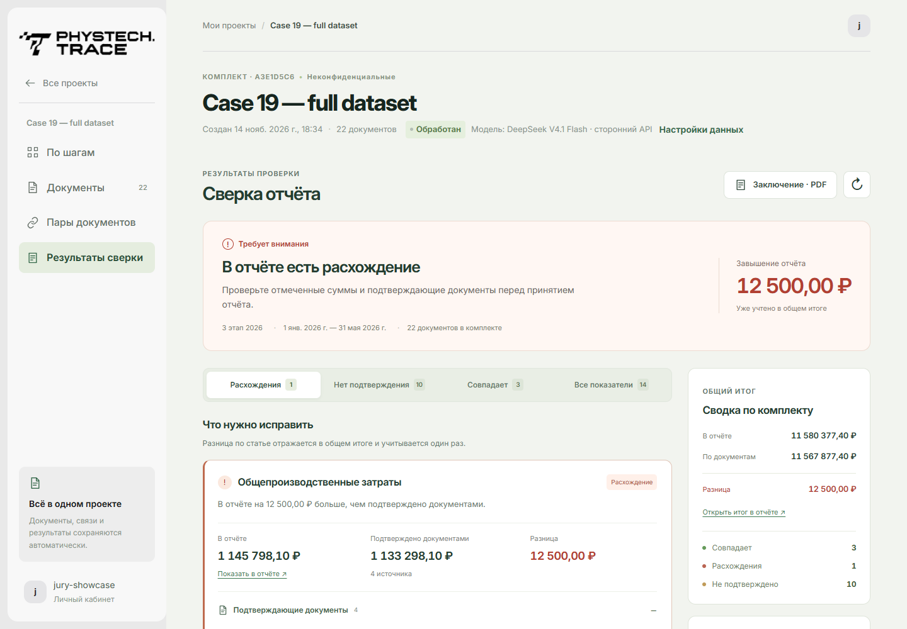
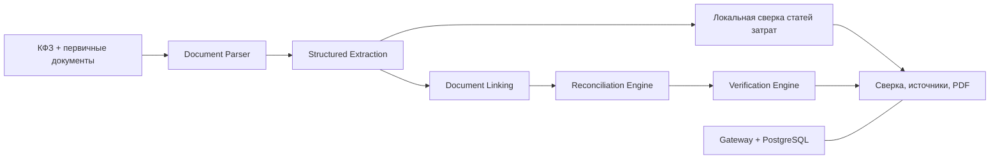

<div align="center">

# Phystech Trace

### От строки отчёта — к подтверждающему документу

Проверка достоверности КФЗ по первичным учётным документам.

[](https://github.com/artemnoor/list-document-viewer/actions/workflows/integration.yml)


[Быстрый старт](#быстрый-старт) · [Для жюри](#соответствие-критериям-кейса) · [Бенчмарки](benchmarks/README.md) · [Модели](docs/models.md) · [Архитектура](phystech-trace/docs/architecture.md)



</div>

**Phystech Trace** принимает итоговый отчёт и комплект PDF, DOCX, XLSX и сканов. Система извлекает показатели, сопоставляет источники, рассчитывает ожидаемые значения и формирует проверяемое заключение. У каждой строки — статус, факт, ожидание, разница и ссылка на исходный фрагмент.

## Что увидит проверяющий

- **Расхождение с объяснением.** Рядом с суммой доступны формула и подтверждающие документы.
- **Контроль договора, периода и дублей.** Исключённые документы сохраняются в аудите с причиной.
- **Три результата.** Совпадает, расхождение, недостаточно данных. Отсутствие первички не превращается в нулевое ожидание.
- **Точные источники.** Страница и фрагмент PDF, лист и ячейка XLSX, адрес значения в JSON Extraction.
- **Заключение и решение специалиста.** PDF, Markdown, JSON; принятие или отклонение сохраняется отдельно от автоматического расчёта.

## Быстрый старт

Нужны Git, Docker Engine / Docker Desktop и Docker Compose v2.24+. Python и Node.js на хосте для запуска приложения не требуются.

```sh
git clone https://github.com/artemnoor/list-document-viewer.git
cd list-document-viewer/phystech-trace
cp .env.example .env
```

В `.env` задайте **свой ключ Polza AI**: `POLZA_API_KEY=...`. Затем:

```sh
docker compose up -d --build
```

Откройте **[localhost:8080](http://localhost:8080)** → зарегистрируйтесь → создайте проект → загрузите КФЗ и первичку → запустите проверку → откройте результат и источники. Для демонстрации используйте открытые, синтетические или обезличенные документы. Первое распознавание может загружать OCR-модели.

Остановка: `docker compose down`. Данные сохраняются в томах. [Окружение, Windows, настройки и два сценария →](docs/getting-started.md)

## Соответствие критериям кейса

[Требования кейса](https://docs.google.com/document/d/19n0jbisDtWv9DuSL6Jt0FfHIAqjtBYLF/edit) сопоставлены с реализацией и проверками. Веса ниже — максимумы критериев жюри, а не присвоенные проекту баллы.

| Критерий | Вес | Реализация и доказательство |
|---|---:|---|
| Извлечение и связывание | 20 | Parser → Extraction → Linking; реквизиты, показатели и provenance. [Контракты](phystech-trace/docs/contracts.md), [тесты](phystech-trace/services/structured-extraction/tests) |
| Расчёт и агрегирование | 16 | Decimal, периоды, знаки, HALF_UP, независимые операции. [15 сценариев](benchmarks/cases.json), [код](phystech-trace/gateway/financial_audit.py) |
| Выявление расхождений | 24 | Факт / ожидание / разница; категории дубля, периода, договора. [Результаты 15/15](benchmarks/results/financial-audit.json), [регрессии](phystech-trace/tests/test_financial_audit_regressions.py) |
| Трассируемость и отчёт | 12 | Источники до конкретного значения, PDF/Markdown/JSON. [Кейс и 93 ссылки](benchmarks/results/case19.json), [скриншоты](docs/screenshots.md) |
| Неполные данные и надёжность | 8 | Неоднозначная сумма, валюта, период и неподтверждённая статья дают непроверенный результат. [Регрессии](phystech-trace/tests/test_financial_audit_regressions.py), [Parser](backend/tests/README.md) |
| Развёртывание и воспроизводимость | 20 | Dockerfile, Compose, настройки, архитектура и use cases. [Docker smoke](scripts/verify_docker.py), [запуск](docs/getting-started.md) |

[Все подкритерии и маршрут демонстрации →](docs/jury-guide.md)

## Контрольный результат

КФЗ за третий этап 2026 года, первичка за январь–май. Повторный расчёт выполнен через Gateway API. Эталон Excel используется только оценщиком и не передаётся модели.

| Показатель | В отчёте, ₽ | По первичке, ₽ | Результат |
|---|---:|---:|---|
| Оплата труда | 5 558 474,83 | 5 558 474,83 | Совпадает |
| Страховые взносы | 1 671 359,96 | 1 671 359,96 | Совпадает |
| Общепроизводственные | 1 145 798,10 | 1 133 298,10 | +12 500,00 |
| Общехозяйственные | 3 204 744,51 | 3 204 744,51 | Совпадает |
| Итого | 11 580 377,40 | 11 567 877,40 | +12 500,00 |

**Одно завышение отражено в статье и общем итоге.** Дополнительно выделены дубль, чужой договор, документ другого периода и 10 непроверенных показателей. [Протокол проверки →](benchmarks/results/case19.json)

## Проверить самостоятельно

```sh
python benchmarks/run.py
python scripts/verify_docker.py --build
```

Первый запуск проверяет 15 публичных синтетических сценариев без ключей и сети. Второй собирает отдельный Compose-проект с новыми томами, проверяет сервисы и удаляет только свой временный стек. [Команды и методика →](benchmarks/README.md)

## Архитектура



Модели помогают интерпретировать документы и связи; суммы проверяются кодом с сохранением источников. В демонстрационном контуре модели вызываются через **Polza AI по вашему ключу**. Gemma 26B A4B и DeepSeek V4.1 Flash используются по ролям; выбор и эксперимент с Qwen3.8 27B описаны в [документации моделей](docs/models.md).

## Документация

| Раздел | Содержание |
|---|---|
| [Запуск](docs/getting-started.md) | Окружение, ключ, команды, остановка, примеры |
| [Для жюри](docs/jury-guide.md) | Подкритерии, код, проверки, демонстрация |
| [Бенчмарки](benchmarks/README.md) | Корпус, gold, метрики, исходные результаты |
| [Модели](docs/models.md) | Конфигурация, эксперимент, локальный контур |
| [Скриншоты](docs/screenshots.md) | Реальный интерфейс на desktop и mobile |
| [Архитектура](phystech-trace/docs/architecture.md) | Компоненты и границы ответственности |
| [Поток данных](phystech-trace/docs/data-flow.md) | От загрузки до заключения |
| [Document Parser](docs/document-parser.md) | Сохранённая подробная документация распознавания |
