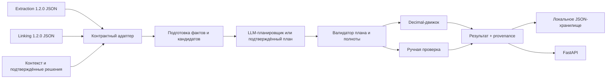

# Архитектура

## Поток данных

## Компоненты

- `contracts.py` применяет upstream JSON Schema Draft 2020-12 и сверяет snapshot extraction/linking по `document_id`, `extraction_id`, версиям и составу.
- `facts.py` строит кандидатов из `fields`, `indicators` и канонического `line_items`. Таблицы не разворачиваются второй раз, чтобы не дублировать строки. Сохраняются исходный и нормализованный value, статус, confidence, идентификаторы строки и locator.
- `planner.py` посылает числовых кандидатов, даты и псевдонимизированную сводку Linking графа в OpenAI-compatible API. Raw `source_value`, координаты и полная provenance не отправляются. При запрете внешней передачи, выключенном LLM или ошибке сетью план не подменяется правилом по названию документа. Закрытые данные доступны только при операторской настройке доверенного локального endpoint.
- `engine.py` валидирует источники, периоды, статусы, единицы, валюты, связи строк и арифметический DAG. Он не исполняет код или выражения от модели.
- `service.py` собирает calculation result, воспроизводимый снимок входов, включённые/исключённые источники, ссылки Linking и диагностики.
- `api.py` публикует `/health`, Swagger, POST/GET API. Результаты хранятся JSON-файлами; текущий storage предназначен для одного процесса/экземпляра.

## Ошибки

Несовместимый upstream JSON или версия приводит к `422 input_contract_error` с точным JSON path. Невалидный AI-план не исполняется и требует ручного решения. Ошибка отдельного target сохраняется в диагностике результата и не превращается в фиктивный ноль.
