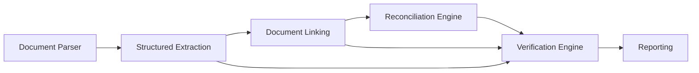

# Архитектура

## Позиция в Phystech Trace

Verification принимает исходные JSON предыдущих этапов, сверяет контракты и references, затем сравнивает actual и expected. Ожидаемые значения, формулы Reconciliation и нормализованные значения Extraction остаются входными данными.

## Компоненты

| Модуль | Ответственность |
| --- | --- |
| `app/api.py` | Versioned REST endpoints, Swagger/OpenAPI и HTTP ошибки |
| `app/contracts.py` | Проверка upstream JSON Schema, версия адаптера, result schema |
| `app/adapters.py` | Разрешение JSON Pointer и доступ к Extraction value wrappers |
| `app/evidence.py` | Проверка документов, строк, provenance и Link evidence |
| `app/comparison.py` | Decimal арифметика и типизированное сравнение |
| `app/classification.py` | Категории доказанных причин и гипотез |
| `app/engine.py` | Порядок проверок, статусы, неопределённость, provenance цепочка |
| `app/storage.py` | SQLite, история, fingerprint идемпотентности |
| `contracts/` | Версионированные входные и выходные JSON Schema |

## Поток запроса

1. API валидирует структуру запроса Pydantic.
2. Contract validator применяет Extraction 1.2.0, Linking 1.2.0 (если передан) и provisional Reconciliation 1.0.0 JSON Schema.
3. Адаптер разрешает точный target JSON Pointer в основном Extraction и каждый `used_sources[].json_pointer` в поддерживающих Extraction.
4. Evidence validator сверяет document/extraction/row IDs, provenance locator, Linking input document, link ID, verification status и путь evidence.
5. Comparison engine проверяет периоды, экономический смысл, валюту, VAT basis, единицы и только затем сравнивает значения.
6. Classification сохраняет факты отдельно от гипотез. SQLite сохраняет исходный результат и fingerprint входов.

При неразрешённой ссылке результат содержит диагностику и остаётся `insufficient_data` или `needs_review`. Математически вычисленная разница может быть сохранена и при недоказанной базе; она не превращается в установленный `mismatch`.

## Хранение и повторный запуск

SQLite файл по умолчанию `data/verification.sqlite3`; путь задаётся через `VERIFICATION_DB_PATH`. SHA-256 fingerprint строится из канонического JSON всего запроса. Повторный идентичный запрос возвращает сохранённый результат с тем же `verification_id` и timestamp.

## Reconciliation adapter и LLM extension point

`app/reconciliation_adapter.py` преобразует provisional Reconciliation 1.0.0 в engine-facing target view без нормализации значений или арифметики. Для настоящего будущего контракта регистрируется отдельный adapter.

`app/explanations.py` реализует необязательный provider Polza AI. Запущенное приложение включает его только при наличии `POLZA_AI_API_KEY`; `create_app()` без явного provider остаётся изолированным для тестов. Gemma получает только pseudonymous metric/evidence tokens, статус, коды диагностики и категории. Суммы, document IDs, labels и исходный текст не отправляются. Ответ ограничивается JSON-схемой гипотез; результат сверяет evidence tokens и добавляет suggestion с `established=false`. Значения, difference и статус не могут измениться через модель. Настройка описана в `docs/polza-ai.md`.
