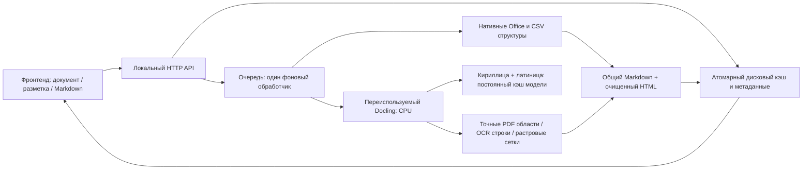

# Аудит документов — 11 ноября 2026

Проверен код приложения, весь предоставленный ZIP и внешние документы. Исправления внесены в рабочий проект. Исходный архив и файлы Downloads не изменялись. Текст документов рассматривался как данные, не как инструкции агенту.

## Проверенный корпус и свидетельства

| Корпус | Входов | Полный прямой прогон | Полный HTTP-прогон |
|---|---:|---:|---:|
| Пользовательский архив | 26 | 26 ready | 26 ready |
| Внешние файлы | 4 | 4 ready | 4 ready |
| Всего | 30 | 30 ready | 30 ready |

Состав: 11 PDF, 12 XLSX, 4 DOCX, 1 PNG, 1 CSV, 1 TXT. В архиве две побайтово одинаковые копии PDF: 30 входов соответствуют 29 уникальным документам. HTTP-проверка подтверждала повторное использование ID при повторной загрузке. Дополнительно создан и проверен через HTTP смешанный PDF с цифровым заголовком и русским сканированным телом: оба фрагмента сохранились, обработка в прогретом тестовом сервере заняла 2,6 с.

`ready` означает завершение конвейера, наличие непустого Markdown и предпросмотра. Это не оценка 100%-й точности OCR. Отдельно проверены конкретные структуры и исходные значения.

Внешние источники:

- [IRS Form W-4, официальный PDF](https://www.irs.gov/pub/irs-pdf/fw4.pdf): форма, многостраничная вёрстка, поля и таблицы.
- [ONS Population estimates time series](https://www.ons.gov.uk/peoplepopulationandcommunity/populationandmigration/populationestimates/datasets/populationestimatestimeseriesdataset): реальные XLSX и CSV.
- [calibre DOCX demo](https://calibre-ebook.com/downloads/demos/demo.docx): официальный сложный пример конвертации Word, а не административный документ; содержит таблицы, списки, ссылки, изображения и примечания.
- Муниципальный Word-шаблон Coventry был найден, но скачивание вернуло HTTP 403. В протестированный корпус он не включён.

Манифесты, контрольные суммы внешних файлов, результаты каждого документа, сравнения OCR и полные локальные свидетельства находятся в `backend/tests/corpus/`. Эта директория исключена из Git, поскольку содержит пользовательские документы и извлечённый текст.

## Подтверждённые ошибки и исправления

| Гипотеза / воспроизведение | Что обнаружено | Исправление / проверка |
|---|---|---|
| Русский скан может технически обработаться, но содержать неверный текст | Стандартная китайско-английская OCR-модель превращала кириллицу в похожие символы | Явно выбран Cyrillic PP-OCRv5 ONNX с латиницей и цифрами. Проверены реальный PNG, скан и английский контроль |
| Первая доступная Cyrillic-модель может оказаться достаточной | PP-OCRv3 улучшила простой PNG, но ухудшила сложный скан | Проверены v3 и v5; оставлена v5, модель проверяется по опубликованной SHA256 и хранится вне репозитория |
| Семантические метки модели надёжны после исправления OCR | Модель называла строки акта checkbox, не определяла таблицу на скане | Нейтральные OCR-строки извлекаются из сохранённых TextCell. Оригинальные предсказания модели остаются в model_parts |
| Таблица может исчезнуть, хотя текст извлечён | У скана карточки расходов Docling возвращал 0 таблиц | По растровым линиям восстановлена сетка 9×17, 109 опорных ячеек с объединениями |
| Таблицы без границ определяются корректно | Год внутри двух колонок обычного текста создавал ложную таблицу; реквизиты обрезались справа | Консервативные numeric-grid и key/value-разборы, проверка межколоночных разрывов; абзацы после реквизитов сохраняются |
| Пустые строки явной сетки несущественны | Пустая строка PDF удалялась, координатная структура менялась | Пустые строки таблиц с границами сохраняются; межстрочные пробелы borderless finder не выдаются за строки данных |
| Наличие цифрового заголовка означает, что OCR не нужен | Сканированное тело той же страницы пропускалось | OCR включается также для больших растровых областей; объединение идёт по областям, не по всей странице |
| Поворот PDF не влияет на рамки | На 90° рамки были смещены | Нативная геометрия переводится в координаты отображаемой страницы; модельная повторно не вращается |
| Порядок строк соответствует порядку чтения | Две колонки перемешивались построчно | Добавлено чтение по колонкам с осторожной проверкой геометрии |
| Разреженный XLSX мал и безопасен | XLSX 4858 байт с форматированием XFD1048576 инициировал обход 17 млрд ячеек | Нативный разбор использует sparse storage openpyxl и явный предел непустых ячеек |
| Два парсера Office улучшают полноту | Один и тот же абзац/таблица попадал в интерфейс дважды | Нативная структура отделена от полного model_parts; адреса, объединения и порядок не дублируются |
| Непустая формула означает наличие результата | У пяти ведомостей итоговая формула не содержит cached result | Сохраняются формула, исходное значение, формат и статус; показано предупреждение, выдуманные суммы не вычисляются |
| DOCX сохраняет всё через paragraph.text | Терялись тела footnote/endnote, URL ссылки, нумерация и вложенность списков, описания изображений | Добавлены отдельные данные этих структур и экспорт примечаний/ссылок/списков; metadata изображений сохраняется |
| HTML-предпросмотр сохраняет литеральный текст | `<customer>…</customer>` исчезал как HTML | Нативный текст экранируется; генерируемые HTML-таблицы проходят allowlist-очистку |
| Широкая таблица просто поместится в экран | 17 столбцов сжимались до переносов по буквам | Горизонтально прокручиваемый контейнер, читаемая ширина и неразрывные числовые ячейки |
| Автоматическое ускорение GPU безопасно в HTTP worker | Установленный CUDA attention kernel циклически выдавал FATAL в фоне | CPU выбран по умолчанию. Все 30 файлов повторно прошли HTTP на CPU. GPU остаётся явной опцией для отдельно проверенного окружения |
| Повторная загрузка восстанавливает временный сбой | Ошибка навсегда оставалась в JOBS | POST /retry и кнопка повторной обработки, защита от дублирования активной задачи |
| JSON-кэш всегда читается целиком | Параллельное чтение недописанного JSON обрывало соединение | Атомарный temp+replace, восстановление повреждённого кэша |
| Двойной выбор того же файла безвреден | В браузере создавались две вложенные панели | Сквозной generation token для всего выбора и polling; браузерная гонка воспроизведена до и после |
| Локальный API изолирован от других сайтов | Wildcard CORS позволял читать локальную библиотеку | Origin allowlist и отклонение чужого POST до выполнения |
| Маленький PDF не может потребовать много памяти | Неограниченная MediaBox приводила к огромному рендеру | Ограничение рендера 12 млн пикселей; контейнеры Office ограничены распакованным размером |

## Проверка точности

Нативные ячейки всех 11 пользовательских XLSX сравнены с openpyxl: 12 листов, 249 непустых ячеек; значения, формулы и объединения сохранены. Нативные абзацы и таблицы трёх пользовательских DOCX сравнены с python-docx. Для сложного внешнего DOCX отдельно воспроизведены потери сносок, ссылок и списков и добавлены регрессии.

На русском PNG читаются заголовок, реквизиты и сумма; на сложном скане появились читаемые русские подписи и содержимое сетки. Английский контроль совпал с исходной строкой. Это ограниченные контрольные примеры: мелкие подписи и отдельные цифры OCR всё ещё могут быть неверными. Встречается, например, «плага» вместо «плата».

## Архитектура после исправлений



Фронтенд остаётся самостоятельным HTTP-приложением, бэкенд — отдельным процессом. Декодирование, геометрия, OCR-профиль, растровые сетки, экспорт и атомарное хранение вынесены в модули. Приложение рассчитано на локальное использование. Обновление страницы не запускает модели заново: документы и готовые результаты восстанавливаются. Старый кэш помечается; обновление анализа запускается явной кнопкой.

## Проверки и команды

- 53 unit/regression tests прошли: API, повреждённый кэш, Origin, retry, ресурсы, разреженный Excel, PDF-геометрия, OCR-профиль, Word, таблицы, безопасный Markdown.
- Прямой полный прогон: 30/30 ready.
- HTTP-проверка upload → analysis → preview → duplicate upload: 30/30 ready, 29 уникальных ID.
- Дополнительный реальный mixed PDF: цифровой заголовок + русский OCR, pass.
- Playwright: скан 9×17 в разметке и Markdown; нейтральные строки PNG; формульное предупреждение Excel; сноски/списки/таблицы DOCX; широкая таблица; гонка выбора одного файла; скачивание Markdown.
- Проверки синтаксиса Python/JavaScript прошли. Дополнительный завершающий review выявил и исправил ещё два края: начальный номер Word-списка и литеральные Markdown-символы в ячейках; OCR-рендер также получил pixel cap, а чрезмерные страницы отклоняются до моделей.

```powershell
python -m unittest discover -s backend/tests -v
python backend/tests/download_public.py
python backend/tests/run_corpus.py after
```

Для HTTP-прогона отдельно запустить `python backend/tests/corpus_server.py` (порт 18766), затем `python backend/tests/run_http_corpus.py`. Скрипты используют тестовое хранилище и не засоряют пользовательскую библиотеку. Манифест пользовательского ZIP создаётся при локальном распаковывании; приватные входы не включены в Git.

## Ограничения, которые остаются

1. OCR не гарантирует точность финансовых сумм; арифметическая сверка документов не реализована.
2. Таблицы без границ, произвольные многоуровневые заголовки и сложный порядок чтения остаются эвристическими. Продолжения таблиц на нескольких страницах автоматически не сливаются.
3. Вычисления Excel не выполняются. Не все специфические Excel number_format визуализируются как в Excel; исходный формат и значение доступны в JSON.
4. В standalone Markdown изображения Word представлены описаниями/метаданными; полноценный пакет Markdown с файлами картинок не создаётся. Многостраничная вёрстка и плавающие объекты Word не воспроизводятся один в один.
5. Для объединённых и вложенных таблиц Markdown использует HTML. Некоторые сторонние просмотрщики HTML в Markdown не поддерживают.
6. Есть программный timeout Docling, но сторонний нативный код в thread нельзя принудительно завершить безопасно. Для более жёсткой изоляции нужен отдельный управляемый worker-процесс; такая переработка сейчас не выполнена.
7. Handwriting, парольные документы, все старые бинарные Office-форматы и произвольные сильно повреждённые файлы этим корпусом не покрыты. Нельзя переносить результаты 30 файлов на все существующие документы.

Итог review: **WARN** — подтверждённые дефекты исправлены и регрессии проходят; остаются перечисленные границы точности и изоляции. Следующий осмысленный набор проверок: эталонные размеченные сканы с поворотом/шумом, многостраничные таблицы-продолжения и файлы с известными итогами для автоматической проверки OCR-цифр.

```aif-gate-result
{"schema_version":1,"gate":"review","status":"warn","blocking":false,"blockers":[],"affected_files":["backend/server.py","backend/storage.py","backend/extraction.py","backend/pdf_layout.py","backend/ocr_config.py","backend/ocr_layout.py","backend/markdown_export.py","frontend/app.js","frontend/annotations.js","frontend/style.css"],"suggested_next":{"command":null,"reason":"Исправления проверены; следующий этап — эталонная оценка OCR и изоляция стороннего кода в worker-процессе."}}
```
