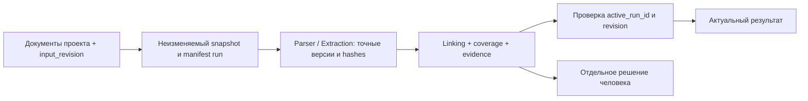

# Phystech Trace: исследование исправления 35 замечаний

Дата: 13.11.2026. Ветка: `feat/phystech-trace-integration`.
Проверенный HEAD: `2e6da4b2b3b57b5c4e9137d8657770beba65ffdf`.

Комплект содержит отдельный документ для каждого замечания из пользовательского аудита, общую модель решения, порядок работ и записку о будущих возможностях КФЗ. Это исследование и предложения к будущей реализации. Код, конфигурация, схема БД, Git history и сервисы не изменялись; Docker/live E2E и платные вызовы моделей не выполнялись.

Исходный [общий план](../phystech-trace-remediation-plan.md), уже находившийся в рабочей папке до этой работы как untracked файл, оставлен без изменений. Настоящий комплект уточняет его по коду и сохранённым отчётам; для деталей использовать карточки ниже.

## Уточнение объёма по оценке пользователя

Все 35 карточек пересмотрены: в начале каждой указан текущий вердикт и минимум следующего MVP. В упрощённых карточках добавлены новые решение/шаги/проверки и критерий приёмки MVP; исходный подробный вариант сохранён ниже как справка для следующих этапов. При расхождении приоритет имеет новый scope. Код по-прежнему не исправляется. Последующая редакция ускоряет переход к моделям, выделяет Parser, упрощает gold, фиксирует Q1 и единый коммитный план.

## Как читать доказательства

- **Подтверждено кодом**: соответствующая конструкция найдена в указанном срезе. Это не доказательство эксплуатации или результат нового runtime-теста.
- **Подтверждено сохранённым отчётом**: прочитаны предыдущие результаты. В этой работе они не воспроизводились.
- **Риск**: структура допускает проблему; для закрытия нужен отдельный воспроизводящий тест.
- **Предложение**: рекомендуемый будущий дизайн, включая новые поля/таблицы/статусы. Он ещё не реализован и требует проверки совместимости.
- Нумерация и серьёзность сохранены по исходному списку, в том числе 🟠 №11 внутри первой группы. Слово «зависимости» в карточке означает связь решений; оно не задаёт DAG и не требует реализовать циклические ссылки по очереди.

В каждой карточке есть источник, причина, рекомендуемый подход, последовательность будущего изменения, проверки, критерий закрытия и ограничения. Названия существующих функций позволяют найти точку изменения через `rg`, даже если номера строк поменяются.

## Индекс 35 проблем

| № | Отдельный документ | Оценка исходного аудита | Объём по оценке пользователя |
| --- | --- | --- | --- |
| 1 | [Document Linking на полном комплекте](01-linking-full-set.md) | 🔴 Критично | Сейчас |
| 2 | [Стабильность результатов Linking](02-linking-stability.md) | 🔴 Критично | Сейчас |
| 3 | [Надёжность LLM-assisted Extraction](03-llm-extraction.md) | 🔴 Критично | Сейчас |
| 4 | [Аутентификация и права в Gateway](04-gateway-authorization.md) | 🔴 Критично | Упростить |
| 5 | [Защита Extraction и доверенная политика LLM](05-extraction-trust-boundary.md) | 🔴 Критично | Сейчас |
| 6 | [Инвалидирование устаревшего Linking](06-result-invalidation.md) | 🔴 Критично | Сейчас |
| 7 | [Изменение комплекта во время обработки](07-uploads-during-processing.md) | 🔴 Критично | Сейчас |
| 8 | [Изоляция проектов и идентичность документов](08-project-isolation.md) | 🔴 Критично | Упростить |
| 9 | [Допуск частичных Parser-результатов](09-parser-quality-gate.md) | 🔴 Критично | Сейчас |
| 10 | [Сквозные версии Parser → Extraction → Linking](10-end-to-end-versioning.md) | 🔴 Критично | Сейчас, упрощённо |
| 11 | [Атомарное выделение версии Extraction](11-atomic-extraction-versions.md) | 🟠 Серьёзно | Сейчас |
| 12 | [Полный конвейер для конфиденциальных комплектов](12-confidential-linking-provider.md) | 🔴 Критично | Позже, до конфиденциального пилота |
| 13 | [Распределённое управление заданиями Gateway](13-gateway-distributed-execution.md) | 🔴 Критично | Упростить |
| 14 | [Проверка восстановления после сбоев](14-recovery-fault-injection.md) | 🟠 Серьёзно | Сейчас, базовые сценарии |
| 15 | [Восстановление повреждённых ответов LLM](15-llm-response-recovery.md) | 🟠 Серьёзно | Сейчас |
| 16 | [Бюджет LLM и отмена на уровне проекта](16-project-budgets-cancellation.md) | 🟠 Серьёзно | Упростить |
| 17 | [Разделение liveness и readiness Gateway](17-gateway-liveness-readiness.md) | 🟠 Серьёзно | Сейчас |
| 18 | [Проверка работоспособности Linking worker](18-worker-health.md) | 🟠 Серьёзно | Позже; простая проверка сейчас |
| 19 | [Production-конфигурация и секреты](19-production-secrets.md) | 🟠 Серьёзно | Сейчас перед публикацией |
| 20 | [Версионированные миграции PostgreSQL](20-database-migrations.md) | 🟠 Серьёзно | Сейчас перед изменением схемы |
| 21 | [Хранение артефактов, архив и очистка](21-artifact-retention.md) | 🟠 Серьёзно | Позже |
| 22 | [Аудит документов в Git](22-tracked-document-audit.md) | 🔴 Критично | Сейчас |
| 23 | [Адрес сервера в Swagger Parser](23-parser-swagger-server.md) | 🟠 Серьёзно | Сейчас |
| 24 | [Swagger UI без внешнего CDN](24-offline-swagger.md) | 🟠 Серьёзно | Сейчас, если нужен offline demo |
| 25 | [Соответствие OpenAPI фактическому API](25-openapi-conformance.md) | 🟠 Серьёзно | Сейчас, базовые smoke-тесты |
| 26 | [Проверка полноты входа Linking](26-linking-input-coverage.md) | 🟠 Серьёзно | Сейчас |
| 27 | [Обратная совместимость контрактов](27-contract-compatibility.md) | 🟠 Серьёзно | Сейчас |
| 28 | [Корректные JSON-пути evidence в Vue](28-evidence-json-paths.md) | 🟠 Серьёзно | Сейчас |
| 29 | [Полный просмотр распознанного документа](29-full-parser-viewer.md) | 🟠 Серьёзно | Позже; полный доступ сейчас |
| 30 | [Просмотр XLSX provenance с контекстом](30-xlsx-evidence-viewer.md) | 🟠 Серьёзно | Позже |
| 31 | [Фактическая доступность сервисов в UI](31-actual-service-status-ui.md) | 🟠 Серьёзно | Сейчас |
| 32 | [Экспертная проверка всех автоматических связей](32-human-review-status.md) | 🟠 Серьёзно | Сейчас |
| 33 | [Вручную проверенный benchmark MVP](33-independent-quality-benchmark.md) | 🟠 Серьёзно | Сейчас |
| 34 | [Репрезентативные сквозные сценарии](34-representative-e2e.md) | 🟠 Серьёзно | Сейчас |
| 35 | [CI общей интеграции](35-integration-ci.md) | 🟠 Серьёзно | Сейчас, поэтапно |

## Существенные уточнения аудита

1. №1: фрагментация, checkpoints, reference registry и correction loop уже существуют. Основная проблема масштаба — в том числе финальная сборка контекста; «просто добавить чанки» недостаточно.
2. №2: ранние live-прогоны действительно дают 0–2 связи, но отчёт содержит промежуточные реализации. Статистику стабильности финального коммита нужно собирать заново на фиксированной конфигурации.
3. №7: Gateway повторно читает документы после Extraction. Новая загрузка может не только остаться вне обработанного snapshot, но и попасть в дальнейший шаг без extraction_result. Конкретный исход completed из описанной последовательности здесь не воспроизведён.
4. №10: input_hash Parser JSON уже сохраняется. Требуется дополнить идентичность upstream/version/configuration, а не убрать существующую защиту.
5. №11: UNIQUE(document_id, version) уже есть. Гонка MAX+1 прежде всего грозит конфликтом INSERT/ошибкой запроса; сохранение одинаковых версий constraint запрещает.
6. №20: у Linking уже есть migration runner с транзакционной advisory lock. Нужно согласовать его с Gateway/Extraction, а не объявлять, что миграций нигде нет.
7. №23: неверный Parser servers.url найден в `phystech-trace/services/document-parser/openapi.json`, который отдаёт `backend/server.py`. Правильный порт Linking 8083 не включён в дефекты.
8. №24: Parser Swagger также использует unpkg.com. Автономную документацию проверять сразу у трёх сервисов.
9. №33: scorer, сценарии и слепые annotation packets подготовлены. Их наличие не означает завершённую независимую разметку или измеренное качество.
10. №22: в HEAD действительно отслеживаются 116 файлов backend/uploads. Содержимое, конфиденциальность и права публикации не классифицировались; в новые документы их данные не копировались.

## Общая модель согласованности

Для следующего MVP достаточно существующих PostgreSQL/JSONB и файлов Parser. Обязательны идентичность проектного экземпляра, неизменяемые входы run и проверка актуальности результата. Отдельный blob registry, object storage и полный artifact lifecycle не входят в текущий объём.

| Минимум MVP | Что обеспечить |
| --- | --- |
| Локальный пользователь и project scope | Одна явно настроенная учётная запись, owner_id и проверка всех data routes. При нескольких субъектах — запрет чужого проекта. |
| Project document instance | Использовать существующий trace_documents.id, scope Extraction/cache/history по project_id + instance; не считать Parser ID правом доступа. |
| Run snapshot / manifest | Полный состав, роли, исходные hashes, версии Parser/Extraction и конфигурации; хранение в существующей БД/файлах допустимо. |
| Активный запуск | Один процесс Gateway, атомарный start/retry, active_run_id и revision checks при записи. Изменение активного комплекта запрещено. |
| Лимиты и результаты | Сохраняемые calls/tokens/time/cancel state; явные partial/failed/coverage. Денежный ledger отложен. |
| Решение эксперта | Машинное и человеческое подтверждение разделены; решение связано с точным run/link/evidence. |

Инварианты сохраняются независимо от упрощения:

- Внешняя LLM разрешается только доверенной серверной политикой проекта. Body-параметры клиента её не расширяют; service secret не выдаётся браузеру.
- Каждый исторический evidence разрешается в том immutable input, на котором построен; mutable latest не подменяет источник.
- При изменении разрешённых входов revision растёт, current result инвалидируется. Старый run не публикуется для новой revision.
- Upload/start сериализованы; во время обработки upload возвращает 409. Будущие revisions с параллельной загрузкой отложены.
- Partial/unknown OCR, «не обработано», «связь не найдена» и human_confirmed различаются.
- Простое ограничение одного Gateway не заявляется распределённой отказоустойчивостью. До включения replicas пересмотреть №13 и внедрить нужное распределённое владение.
- Confidential остаётся blocked, пока внутренний provider не реализован и не прошёл E2E. Разрешённый тестовый MVP не доказывает готовности к confidential-пилоту.
- Неизвестный usage не равен нулю, отмена предотвращает новые вызовы; отмену уже принятого провайдером запроса гарантировать нельзя.
- Совместимость существующих форматов 1.2.0 сохраняется; новые поля/envelope требуют проверки №27.

Полная нормализованная модель artifacts, queue/lease/fencing, финансовый budget ledger, IdP/RBAC и retention/GC остаются вариантами дальнейшего развития. Они не являются скрытыми prerequisites текущего MVP. Справочные расширенные варианты сохранены в соответствующих карточках.

## Предлагаемая очередь работ

Очередь пересмотрена по последнему замечанию: полноценная схема данных и оркестрация больше не стоят перед первым исправлением моделей. Единственный checklist разработки — [PLAN.md](../../.ai-factory/PLAN.md); карточки обосновывают решения.

| Этап | Малый обязательный объём | Коммиты/переход |
| --- | --- | --- |
| 0. Честное измерение | Один вручную проверенный небольшой gold, исправление scorer, Q1 и frozen protocol; CI unit/contracts/build начинается сразу | C01–C03. Q1 предварительно утверждён; ручные labels и baseline не выполнены. |
| 1. Минимальный периметр и baseline | Закрыть прямые Parser/Extraction data APIs, простая Gateway auth, доверенная external policy; использовать immutable разрешённые snapshots | C04a–c и C05. Никаких IdP, blob registry, полной distributed queue или масштабного schema refactor. Запуск тестов отдельно согласуется. |
| 2. Сразу надёжность моделей | №01 bounded tasks/merge, №15 bounded repair, №03 grounded staged Extraction; coverage в этих же задачах | C06–C09 — до основной доработки Gateway storage/versions/recovery. Q0 требует реального baseline до оптимизации. |
| 3. Целостность MVP | Минимальные миграции, project scope, атомарные versions, manifest/current invalidation, active upload ban, policy допуска и persistable limits | C10–C14; обязательны для приёмки MVP, но не задерживают модельную работу на frozen inputs. |
| 4. Проверяемость и диагностика | Правильные evidence paths/human decisions/full JSON, live/ready/service UI, базовый recovery/API smoke | C15–C19, без развитых viewers или полного chaos-suite. |
| 5. Измеренная приёмка | Аудит Git, representative mock E2E в CI и отдельно разрешённый live comparison на том же gold/Q1 | C20/C21; аудит C20 начинается с начала, условные действия — после проверки прав. |

Q1: [числа, допустимые ошибки и лимиты](38-quality-gates.md). Один разметчик допустим для ближайшего MVP; двойная разметка и арбитраж не являются early gate. Новый baseline не подменяется старым smoke-отчётом или скором только первого повтора.

### Условные этапы

- **До публикации:** №19, уникальные secrets/production validation, closed ports и повторная проверка всего периметра, включая Parser.
- **Для offline demo:** №24 локальные Swagger assets; доступ к docs согласуется со скрытыми data ports и не раскрывает service credentials.
- **До confidential-пилота:** №12 внутренний provider + no-egress E2E/quality; сейчас confidential blocked.
- **До Gateway replicas:** расширенный №13 queue/lease/fencing; current single-process design не готов к этому режиму.

### Следующий backlog

Расширенные №12/18/21/29/30, IdP/RBAC, artifact registry/retention, financial ledger, полный chaos/conformance и live automation. [Предметный план №36](36-kfz-product-scope.md) пересмотрен: после C21 отдельные design tasks D01–D05 по ОСВ/показателям, расчётам, агрегации/периодам, сверке и заключению. Они не задерживают стабилизацию интеграции.

## Минимальные условия готовности к объединению/пилоту

Эти условия уточнены под следующий стабильный локальный MVP, работающий с разрешёнными тестовыми данными и одним Gateway. Они не заявляют готовности публичного или confidential-контура.

1. Gateway data routes требуют local auth; прямые Parser source/analysis/pages и все mutation endpoints закрыты отдельным service guard/private network, как Extraction. Данные/история изолированы по проекту, внешняя LLM использует доверенную policy.
2. Run имеет immutable manifest; active inputs нельзя менять. Инвалидация, повторный запуск и базовое recovery не делают старый граф актуальным.
3. Полный пятидокументный комплект и репрезентативные положительные, отрицательные и неоднозначные сценарии проходят в заявленных resource limits без тихих пропусков.
4. LLM-required Extraction реально проходит PDF/XLSX/DOCX и сложные таблицы. Rules-only остаётся отдельным режимом, не доказательством LLM-успеха.
5. Все evidence paths разрешаются в точном snapshot; машинное и человеческое подтверждение разделены. Полный Parser JSON доступен, но виртуализация/XLSX grid не требуются.
6. До оптимизации утверждён Q1 и измерен baseline на небольшом gold, вручную проверенном одним человеком до predictions. После изменений — тот же протокол. Два эксперта позже; без реально проверенных labels/измерений нельзя утверждать рост точности.
7. Есть unit/contract/build/mock E2E в реально выполненном CI, базовые HTTP smoke/readiness и restart checks. Отдельный управляемый live E2E подтверждает модельный путь; автоматизированный live workflow/полный chaos-suite не обязательны.
8. По документам в Git выполнен аудит разрешений и приняты меры по его выводам; неизвестный публикационный статус не объявляется разрешением. Подготовка плана не означает, что аудит или удаление уже выполнены.

Отдельные gates публикации, offline demo, confidential-пилота и горизонтального масштабирования указаны выше. Отложенные улучшения остаются открытыми; MVP-приёмка не закрывает их задним числом. Решение о merge принимает владелец репозитория на основе фактических результатов.

## Что пока неизвестно

- Ручные gold labels, перечень критичных полей, reviewer identity и измеренный baseline. Числа Q1 уже предварительно утверждены; application/model tests и live exposure ещё не согласованы.
- Фактическая производительность/стоимость в предварительно утверждённых лимитах Q1; бюджет/доступ конкретного запуска тестов.
- Настройка локального владельца и credentials, правила миграции существующих проектов. Организационный IdP и расширенные роли отложены.
- Для будущего confidential-пилота: утверждённая внутренняя модель, её revision, инфраструктура и измеренное качество; локальный тестовый MVP от неё не зависит.
- Источник конкретного POLZA_UNGROUNDED_OUTPUT: для окончательной диагностики нужен безопасно сохранённый неуспешный request/response.
- Статус публикационных разрешений на 116 файлов и весь исторический корпус.
- Точный смысл ОСВ и правила сверки по интервью заказчика: сам текст интервью в рамках исследования не предоставлен.
- Новые runtime/fault-injection результаты: в этой работе их нет.

## Дополнительные документы

- [Отложенные возможности КФЗ: семь направлений](36-kfz-product-scope.md).
- [Источники, методика и границы проверки](37-evidence-and-validation.md).
- [Q1: предварительно утверждённые числовые критерии и лимиты](38-quality-gates.md).
- [Явная защита Parser: endpoint matrix и ранний коммит](39-parser-access-boundary.md).
- [Единый исполняемый план по коммитам](../../.ai-factory/PLAN.md).

## Active Summary (input for $aif-plan)

<!-- aif:active-summary:start -->
Topic: Стабильный локальный MVP Phystech Trace, 35 замечаний и шесть последующих уточнений пользователя.
Цель: ранний bounded Linking/grounded Extraction/repair после честного baseline и минимального периметра.
Ограничения: только документы; код, конфигурация и БД не менялись. Пользователь предварительно утвердил Q1; запуск application/model tests согласуется отдельно, сейчас не разрешён.
Порядок: C01–C03 измеритель/малый single-reviewer gold/ранний CI; C04a–c прямой Parser/Extraction периметр и local auth; C05 frozen measured baseline; C06–C09 немедленно №01/15/03; затем C10–C21 integrity/UI/recovery/E2E.
Измерения: Q1 предварительно утверждён 13.11.2026 20:35 МСК; P≥.95, R≥.90, F1≥.92, rowP/R≥.90, evidence/coverage100%, Jaccard mean≥.90/min≥.80, 6 комплектов×5 повторов и limits из38. Реальный baseline не измерен; gold и критичные поля должен проверить человек до predictions.
Периметр: Parser source/content/analysis/pages/list/upload/retry/review/delete закрыты внутренним guard и private port в будущей C04a; это план, не уже выполненная защита.
Архитектура MVP: существующие PostgreSQL/files, project scope, immutable snapshots/manifest, один Gateway, ресурсные counters; enterprise storage/IdP/queue/ledger отложены.
После стабилизации: отдельные design tasks D01–D05 из36 для ОСВ, финансовых расчётов, периодов и сверки КФЗ. Формулы и financial tolerance не выдумывать.
Единый план: .ai-factory/PLAN.md — точные коммиты, файлы, миграции, тесты, logging и completion criteria; все implementation tasks открыты.
Открыто: ручной gold, критичные поля, measured baseline, назначение владельцев, публикационные права, тестовый execution/exposure. Второй разметчик/арбитр не обязательны для ближайшего MVP.
<!-- aif:active-summary:end -->

## Sessions

<!-- aif:sessions:start -->
### 13.11.2026 — Завершено исследование 35 замечаний

Сохранены карточки 01–35, индекс и записки 36–37. Проверено точное покрытие нумерации, обязательные разделы и локальные ссылки. Независимая read-only проверка всех 38 документов: Research Coherence Gate — PASS, содержательных противоречий не обнаружено. Реализация и runtime/live проверки не выполнялись; tracked diff пуст.
### 13.11.2026 — Объём уточнён по оценке пользователя

Во всех 35 карточках добавлены вердикты и границы следующего MVP; в упрощённых/поэтапных планах отдельно описаны минимальные решение, шаги, проверки и критерий приёмки. Первоначальные расширенные варианты сохранены как будущая справка. Индекс, очередь, gates и Active Summary согласованы с локальным single-process профилем. Повторный независимый read-only Research Coherence Gate — PASS; содержательных противоречий не обнаружено. Код и runtime не изменялись.

### 13.11.2026 — Учтены шесть замечаний и предварительно утверждён Q1

Перед основной доработкой данных поставлен ранний модельный цикл после измерителя/baseline и минимального периметра. Созданы единый .ai-factory/PLAN.md с 24 коммитными задачами, числовой контракт38 и явная endpoint matrix39 Parser. Карточка33 перешла на один вручную проверенный эталон;36 дополнен отдельными design tasks D01–D05 после стабильной интеграции. Пользователь предварительно утвердил Q1 20:35 МСК, отдельно сохранив требование согласовать запуск тестов. Baseline, ручные labels, application/model tests и implementation остаются невыполненными. Независимая read-only проверка плана помогла конкретизировать per-send policy hooks, baseline runner и Extraction scorer; замечания исправлены. Проверка ссылок/таблиц/task order и обоих provenance hashes прошла, без исполнения приложения.

<!-- aif:sessions:end -->
