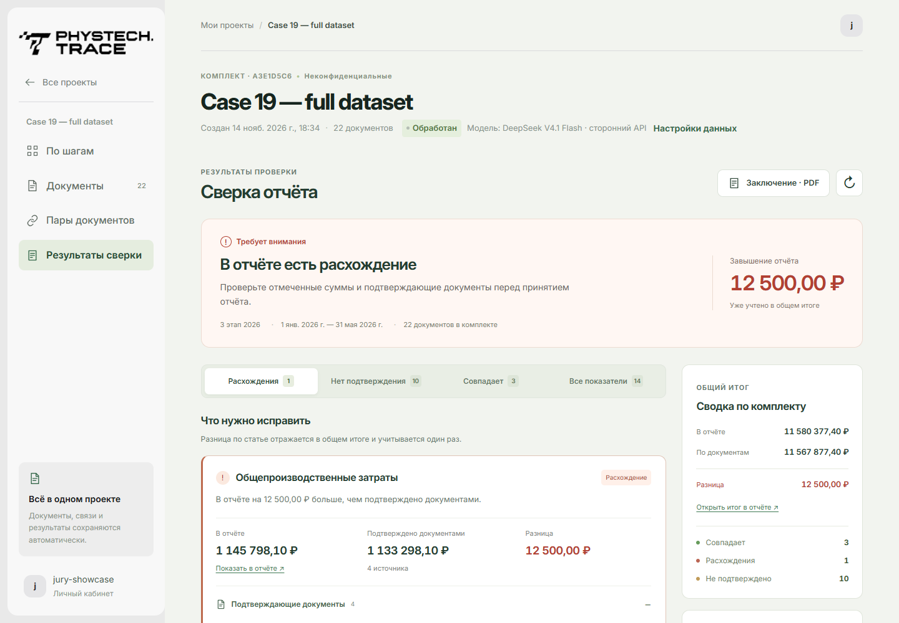
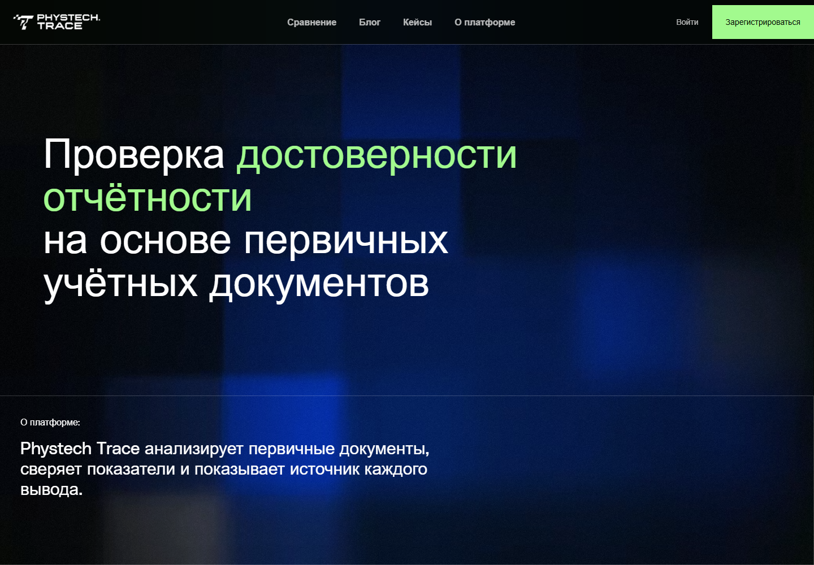
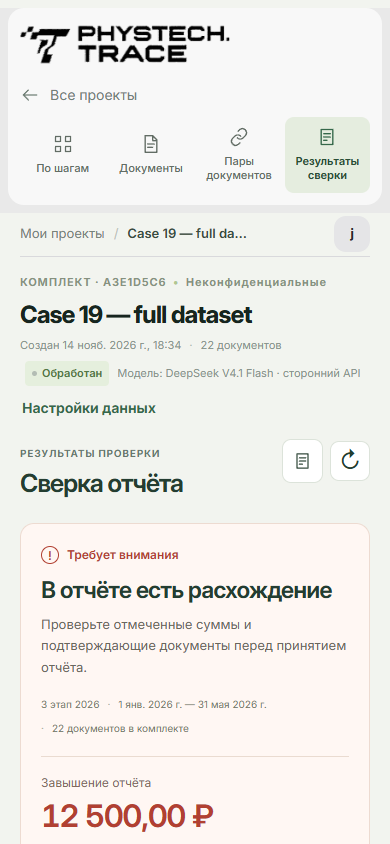

[← Модели](models.md) · [README](../README.md)

# Реальный интерфейс

Скриншоты сняты Playwright с работающего локального приложения 14 ноября 2026 года. Суммы и статусы показаны из сохранённого контрольного проекта, без подмены API. Использован отдельный демонстрационный аккаунт.

## Сверка отчёта

## Вход в продукт

## Мобильный экран

Оформление README ориентировано на навигацию и визуальную подачу [Paperless-ngx](https://github.com/paperless-ngx/paperless-ngx), [Stirling PDF](https://github.com/Stirling-Tools/Stirling-PDF) и [AppFlowy](https://github.com/AppFlowy-IO/AppFlowy): краткое описание, видимый продукт, быстрый старт и отдельные страницы технических доказательств. Скриншоты этих проектов не копировались.

## См. также

[Для жюри](jury-guide.md) · [Запуск](getting-started.md) · [Бенчмарки](../benchmarks/README.md)
